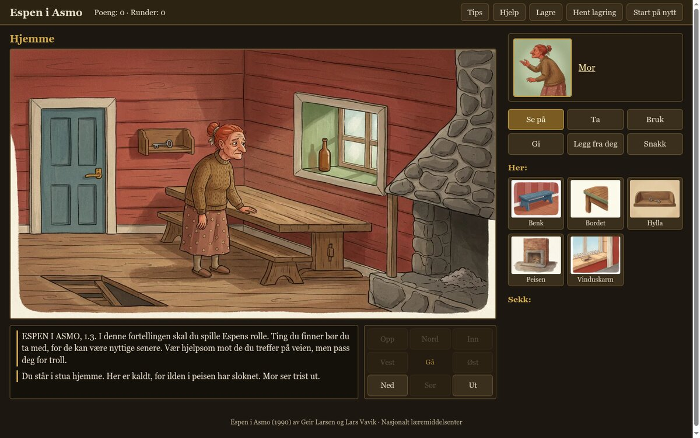
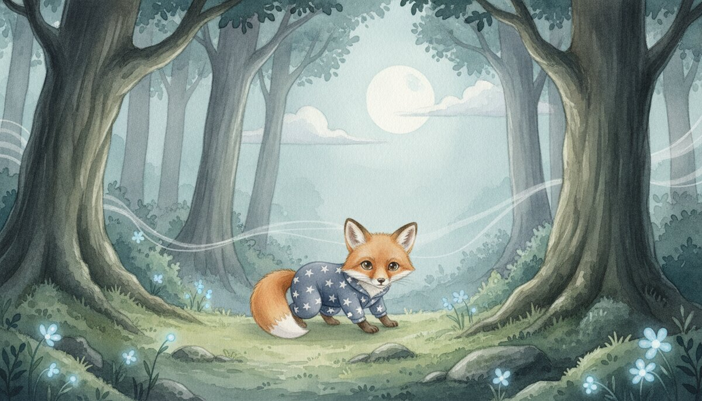
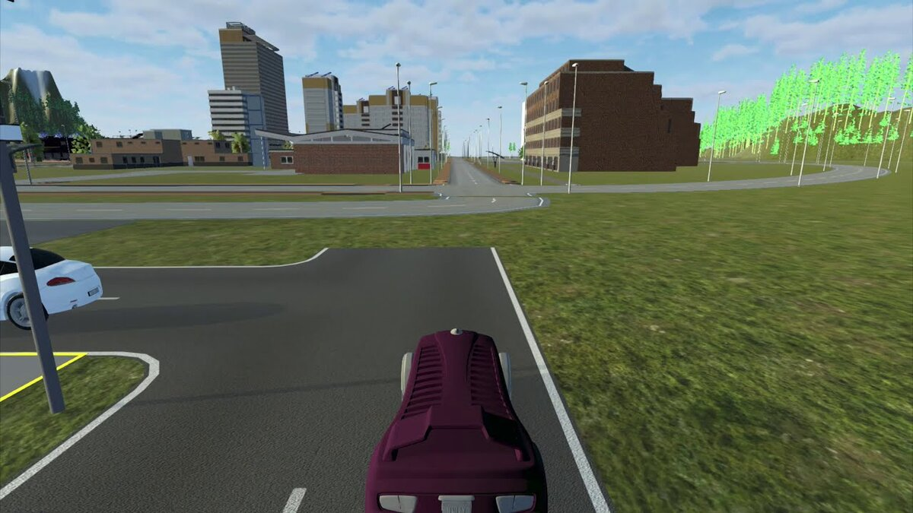

## John Inge Erlandsen

I build software for a living. This is where the things I make for myself end up.

Most of them start with something at home: a game I played as a kid, bedtime stories,
my own savings, a raid log I wanted to understand.

### Espen i Asmo

A Norwegian adventure game for DOS from 1990, published by Nasjonalt læremiddelsenter. I took the two
original floppy images apart, worked out the game's data format and rebuilt it for the
browser with new illustrations. The story and the text are the original's, published
with permission from the authors, Geir Larsen and Lars Vavik. *(In Norwegian.)*

[espeniasmo-preview.fly.dev](https://espeniasmo-preview.fly.dev) ·
[source](https://github.com/erlandsen-tech/espeniasmo-remake)

  

### Drømmevev

A picture-book maker for bedtime. A parent or a child gives the idea, a photo of the
child or a drawing, and it becomes an illustrated story with the child as the hero, one
page at a time, ending in sleep. The characters look the same on every page.
*(Private for now.)*

  

### finai

A command-line tool for my own investing. It pulls market data from several sources
(Yahoo, FRED, Finnhub, Børsdata, Norges Bank, Brønnøysund), values companies with
several methods side by side and tracks a portfolio in a local database. An AI agent
gets the same functions through MCP, so it can do the legwork and I can check the
numbers. *(Private for now.)*

  

### SMACS

My bachelor project, made with Oracle: a smart-city simulator in Unity. A small city where pedestrians and cars
find their own way, taxis come when you call them, rubbish trucks empty the bins that
report themselves full, and street lights, parking spaces and crossings talk to a
backend over REST.

[video](https://www.youtube.com/watch?v=HnLU356ZHac) ·
[scripts](https://github.com/erlandsen-tech/SmacsScripts)

  

### Fakturio

Invoicing for Norwegian sole proprietors who send a handful of invoices a year. Buy a
pack of invoices, send them as PDF or as EHF over PEPPOL, no subscription. Built,
launched and parked: the market already had enough of these.

[fakturio.no](https://fakturio.no) ·
[source](https://github.com/erlandsen-tech/fakturia)

  

## Smaller things

- [wcl-toolkit](https://github.com/erlandsen-tech/wcl-toolkit): compares a World of
  Warcraft raider against the ranked players of the same class and spec on each boss,
  and turns the difference into a short list of things to fix.
- [game-review-agent](https://github.com/erlandsen-tech/game-review-agent): a review
  skill for Claude Code and Codex that goes through a game in eight passes and has to
  show evidence for every finding.
- [youtube-music-mcp](https://github.com/erlandsen-tech/youtube-music-mcp): lets Claude
  build my playlists, because I am lazy.
- [quest-wall](https://erlandsen-tech.github.io/quest-wall/): my to-do list as a quest
  log, with XP, levels and a streak.

## In the workshop

*Private for now.*

### Understudy

A rehearsal stage for AI agents that are about to get real authority. A simulated
world, agents that act in it, and a record of what they were allowed to do next to what
they did, so you can watch one fail where failing is free.

### Worldsmith

A worldbuilding engine: people, places, factions and beliefs kept as one coherent
model that several story products can read from. It is the narrative brain behind
Drømmevev.
